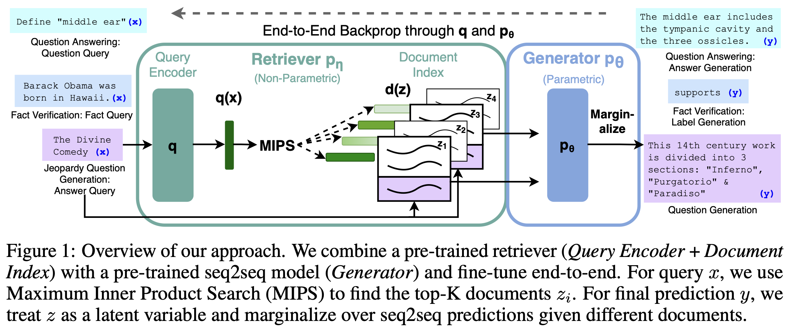

<!-- _class: title -->

# Introduction aux LLMs
## Séance 4 : Utilisation et intégration d'outils

**ESGI Paris**
Célia Nouri · `celia.nouri@inria.fr`
Semestre 1, 2026–2027

---

# Agenda

1. Évaluation
2. Prompting : zero-shot, few-shot, Chain-of-Thought
3. Retrieval-Augmented Generation (RAG)
4. Appel d'outils et function calling (Toolformer)
6. Lab 4 : Prompting et RAG

---

<!-- _class: section -->

# 1. Évaluation

---

## Pourquoi évaluer un LLM est difficile

<br>

- Un LLM est **généraliste** : pas de tâche unique à mesurer
- Les benchmarks se **saturent** vite (un nouveau modèle bat le précédent record en quelques mois)
- Risque de **contamination** : le benchmark peut avoir fuité dans les données de pré-entraînement (section 2)
- Un bon score sur un benchmark ne garantit pas une bonne expérience utilisateur réelle

---

## Benchmarks académiques classiques

<br>

| Benchmark | Mesure | Format |
|---|---|---|
| **MMLU** (Hendrycks et al., 2020) | Connaissances générales, 57 matières | QCM |
| **HellaSwag** (Zellers et al., 2019) | Sens commun, complétion de phrase plausible, mauvaises réponses construites par **filtrage adversarial** (*Adversarial Filtering*) | QCM |
| **GSM8K** (Cobbe et al., 2021) | Raisonnement mathématique (niveau collège) | Problèmes ouverts |
| **HumanEval** (Chen et al., 2021) | Génération de code fonctionnel | *pass@k* (le code s'exécute-t-il ?) |

<br>

Ces benchmarks apparaissent systématiquement dans les *model cards* (GPT-4, Claude, LLaMA, Gemini…) pour comparer les modèles.

---

## Deux précisions sur ces benchmarks

<br>

**HellaSwag** n'est pas juste "difficile par hasard" : ses mauvaises réponses sont construites par **filtrage adversarial** (*Adversarial Filtering*) — un modèle génère plusieurs fins de phrase plausibles, on ne garde que celles qui **trompent des modèles** tout en restant **évidentes pour un humain**. Le benchmark est donc conçu spécifiquement pour être dur pour les machines.

<br>

**HumanEval** ne veut pas dire "évalué par des humains" : le nom vient du fait que les **164 problèmes de programmation sont écrits à la main** par des humains (énoncé + tests unitaires). L'évaluation elle-même est **automatique** : le code généré est exécuté contre les tests, et *pass@k* mesure la proportion de problèmes résolus, aucun jugement humain n'intervient dans la note.

---

## Le problème de la contamination

Les modèles sont entraînés sur **une grande partie du web** qui contient parfois les benchmarks eux-mêmes, ou leurs solutions.

<br>

```
MMLU publié (2020) → corrigés/fiches de révision postés sur GitHub, Quizlet...
                   → ces pages indexées et présentes dans Common Crawl (2022+)
                   → potentiellement vues pendant le pré-entraînement d'un modèle
                   → score artificiellement élevé au moment de l'évaluation
```

<br>

Conséquence : un score MMLU élevé peut refléter de la **mémorisation** plutôt que de la **généralisation**. D'où l'intérêt de benchmarks récents, privés, ou renouvelés régulièrement.


---

## Comparaison des LLMs 

Face aux limites des QCM, deux approches complémentaires :

<br>

**Chatbot Arena** (LMSYS, 2023) : des humains comparent en aveugle les réponses de deux modèles à un même prompt et votent pour la meilleure → classement de type **Elo** (comme aux échecs).

<br>

> **Rappel — le classement Elo** : chaque modèle a un score. Avant un match, on calcule sa **probabilité attendue de gagner** à partir de l'écart de score avec l'adversaire. Après le match, son score est ajusté : gagner contre un modèle **mieux classé** rapporte plus de points que gagner contre un modèle plus faible (et l'inverse pour une défaite).

---

## LLM-as-judge


**LLM-as-judge** (MT-Bench, Zheng et al., 2023) : on utilise un LLM puissant (GPT-4, Claude) pour **noter automatiquement** les réponses d'autres modèles selon une grille de critères explicités dans le prompt.

<br>

⚠️ **Zheng et al. (2023)**, dans ce même papier MT-Bench, mesurent et documentent trois biais du LLM-as-judge : préférence pour les réponses **longues** (*verbosity bias*), pour son **propre style** de génération (*self-enhancement bias*), et sensibilité à l'**ordre de présentation** des réponses comparées (*position bias*).

---

<!-- _class: quiz -->

## 🧩 Quiz — Évaluation

<br>

**1.** Pourquoi un score élevé sur MMLU ne garantit-il pas qu'un modèle est réellement meilleur ?

**2.** Quelle est la différence entre l'évaluation Chatbot Arena et un benchmark comme HumanEval ?

**3.** Citez un biais connu du LLM-as-judge.

---

<!-- _class: quiz -->

## 🧩 Quiz — Réponses

**1.** Risque de **contamination** : le benchmark (ou ses réponses) peut avoir été vu pendant le pré-entraînement, gonflant artificiellement le score sans réelle généralisation.

**2.** Chatbot Arena repose sur des **comparaisons humaines en aveugle** avec classement Elo ; HumanEval est un test **automatique** (le code s'exécute-t-il correctement ?).

**3.** Préférence pour les réponses longues, préférence pour son propre style de génération, ou sensibilité à l'ordre de présentation des réponses comparées.

---

## Ressources — Évaluation

<br>

📄 **MT-Bench / Chatbot Arena** : Zheng et al. (2023); arxiv.org/abs/2306.05685

📖 **LMSYS Chatbot Arena** : [arena.ai](https://arena.ai/leaderboard/agent)

---

<!-- _class: section -->

# 2. Prompting

---

## Le prompt comme levier

Une fois le modèle pré-entraîné, instruction-tuné et aligné (séance 3), on ne le **ré-entraîne pas** à chaque nouvel usage.

<br>

Le **prompt** — le texte qu'on envoie au modèle — devient le principal levier pour changer son comportement, **sans toucher aux poids**.

<br>

```
Fine-tuning / RLHF  : modifie les poids du modèle          (coûteux, lent)
Prompting           : modifie seulement l'entrée du modèle (gratuit, instantané)
```

<br>

C'est ce qu'on appelle l'**apprentissage en contexte** (*in-context learning*).

---

## Zero-shot prompting

Le modèle reçoit uniquement une **instruction**, sans aucun exemple de ce qu'on attend.

<br>

```
Prompt :
"Classe ce message parmi {Spam, Non-spam} :
 'Félicitations ! Vous avez gagné un iPhone, cliquez ici pour le réclamer.'"

Réponse attendue : Spam
```

<br>

**Radford et al. (2019, OpenAI)** dans *"Language Models are Unsupervised Multitask Learners"* (papier **GPT-2**) montrent les premiers qu'un LLM suffisamment grand peut réaliser des tâches (traduction, résumé, QA...) en zero-shot, sans avoir jamais été explicitement entraîné dessus, simplement en formulant la tâche comme un prompt en langage naturel.

---

## Few-shot prompting

On ajoute quelques **exemples** (*demonstrations*) dans le prompt avant la vraie requête, toujours **sans mise à jour des poids**.

<br>

```
Prompt : "Analyse le sentiment (Positif/Négatif/Neutre) :

Avis : 'Livraison rapide, produit conforme, rien à redire.'
Sentiment : Positif

Avis : 'Deux semaines d'attente et l'article était cassé.'
Sentiment : Négatif

Avis : 'Correct pour le prix, sans plus.'
Sentiment :"
```

<br>

**Brown et al. (2020, OpenAI)** dans *"Language Models are Few-Shot Learners"* (**GPT-3**) montrent qu'ajouter des exemples dans le prompt **améliore la performance**, et que ce gain du few-shot **s'accentue à mesure que le modèle grandit** (175B tire bien plus parti des exemples qu'un petit modèle).

---

## Pourquoi l'in-context learning fonctionne-t-il ?

Une question encore débattue en recherche.

<br>

**Min et al. (2022)** dans *"Rethinking the Role of Demonstrations"* : résultat surprenant : remplacer les **bons labels** des exemples par des labels **aléatoires** ne dégrade que peu la performance sur beaucoup de tâches.

<br>

→ Le modèle apprend surtout le **format** de la tâche (quel type de sortie produire) et l'**espace des réponses possibles**, pas nécessairement la relation input→output à partir des exemples eux-mêmes.

<br>

**Xie et al. (2022)** proposent une autre lecture : le prompt agirait comme un indice qui aide le modèle à **retrouver**, parmi les tâches implicitement apprises au pré-entraînement, celle qu'on veut lui faire exécuter.

---

## Chain-of-Thought (CoT) prompting

**Wei et al. (2022, Google)**, *"Chain-of-Thought Prompting Elicits Reasoning in LLMs"*.

<br>

**Idée** : demander au modèle d'expliciter son raisonnement **étape par étape** avant de donner la réponse finale, plutôt que de répondre directement.

<br>

```
Sans CoT :
Q: Un serveur traite 240 requêtes en 4 secondes. Combien de secondes
   pour traiter 900 requêtes au même débit ?
A: 12                                              ← souvent faux

Avec CoT :
Q: [même question]. Explique ton raisonnement étape par étape.
A: Le débit est 240/4 = 60 requêtes/seconde.
   Pour 900 requêtes : 900/60 = 15 secondes.
   Réponse : 15                                    ← correct
```

---

## CoT : zero-shot et self-consistency

**Kojima et al. (2022)** dans *"LLMs are Zero-Shot Reasoners"* : il suffit d'ajouter **"Let's think step by step"** à la fin du prompt, **sans aucun exemple**, pour déclencher un raisonnement explicite et améliorer nettement les scores sur des benchmarks de raisonnement.

<br>

**Wang et al. (2022)** introduit la *self-consistency* : générer **plusieurs** chaînes de raisonnement (en échantillonnant, pas en greedy) pour la même question, puis garder la réponse finale **majoritaire**.

```
Chaîne 1 → réponse : 15
Chaîne 2 → réponse : 15
Chaîne 3 → réponse : 12
                        → réponse retenue : 15 (majorité)
```

---

<!-- _class: quiz -->

## 🧩 Quiz — Prompting

<br>

**1.** Quelle est la différence fondamentale entre le fine-tuning et le prompting pour adapter un modèle à une tâche ?

**2.** Min et al. (2022) remplacent les labels corrects des exemples few-shot par des labels aléatoires. Que révèle ce résultat sur ce que le modèle apprend réellement du prompt ?

**3.** Que change concrètement le Chain-of-Thought dans la façon dont le modèle produit sa réponse ?

---

<!-- _class: quiz -->

## 🧩 Quiz — Réponses

**1.** Le fine-tuning **modifie les poids** du modèle (coûteux, permanent) ; le prompting ne modifie que le **texte d'entrée**, à poids figés (gratuit, réversible, instantané).

**2.** Le modèle s'appuie surtout sur le **format** de la tâche et l'espace des réponses attendues, pas uniquement sur la relation input→output démontrée dans les exemples.

**3.** Le modèle génère un raisonnement intermédiaire, token par token, **avant** la réponse finale. Chaque étape de raisonnement conditionne la suivante, ce qui améliore les tâches nécessitant plusieurs étapes de calcul ou de logique.


---

<!-- _class: section -->

# 3. Retrieval-Augmented Generation (RAG)

---

## Le problème des connaissances figées

Un LLM ne connaît que ce qu'il a vu au pré-entraînement (séance 3) :

<br>

- Ses connaissances s'arrêtent à une **date de coupure** (*knowledge cutoff*)
- Il n'a **aucun accès** aux documents privés d'une entreprise, à une base de code interne, ou à des données mises à jour après son entraînement
- Il peut produire une réponse **incorrecte formulée avec le même style assuré qu'une réponse correcte** — rien dans le texte généré ne signale l'incertitude ou l'absence de connaissance réelle

<br>

Ré-entraîner ou fine-tuner le modèle à chaque mise à jour de connaissance serait beaucoup trop coûteux.

---

## Le pipeline RAG

**Lewis et al. (2020, Facebook AI)** dans *"Retrieval-Augmented Generation for Knowledge-Intensive NLP Tasks"*.

<br>

```
[Corpus de documents]
        ↓ embeddings (séance 1/2)
[Base vectorielle]

[Question utilisateur] → embedding → recherche des k passages
                                      les plus proches (similarité cosinus)
                                            ↓
                        [passages retrouvés + question] → Prompt du LLM
                                            ↓
                                    Réponse générée
```

<br>

Le LLM **n'est jamais ré-entraîné** : les documents retrouvés sont simplement injectés comme contexte dans le prompt.

---

## Le pipeline RAG

<center></center>


---

## RAG : un exemple concret

**Sans RAG**, une question sur une politique interne à l'entreprise, absente des données d'entraînement :

```
Q : "Quelle est la limite de requêtes par minute de notre API interne
     `PaymentGateway` ?"
R : "En général, ce type d'API interne impose une limite de l'ordre
     de 100 à 1000 requêtes par minute selon la charge..."
     ← plausible, mais inventé : le modèle n'a jamais vu cette doc
```

<br>

**Avec RAG**, le passage pertinent de la documentation interne est injecté dans le prompt :

```
Contexte injecté : "PaymentGateway applique un quota de 240 requêtes/min
                     par client, avec un burst autorisé de 400 requêtes
                     sur 10 secondes (doc interne, révision 2025-11)."
Q : "Quelle est la limite de requêtes par minute de PaymentGateway ?"
R : "240 requêtes par minute par client, avec un burst possible de
     400 requêtes sur 10 secondes."   ← ancré dans la vraie doc
```

---

## Composants pratiques d'un système RAG

<br>

| Composant | Rôle | Exemples |
|---|---|---|
| **Chunking** | Découper les documents en passages | taille fixe, par paragraphe, overlap |
| **Embedding model** | Vectoriser chunks et requêtes | `sentence-transformers` (ecodeur) |
| **Base vectorielle** | Stocker et rechercher par similarité | FAISS (Johnson et al., 2019), Pinecone, Chroma |
| **Génération** | Produire la réponse finale | n'importe quel LLM (via prompt) |

<br>

**FAISS** (*Facebook AI Similarity Search*) permet de rechercher les voisins les plus proches parmi des **milliards** de vecteurs efficacement (recherche approximative sur GPU).

---

## Limites du RAG

<br>

- La retrieval peut **échouer** : passages non pertinents récupérés → réponse basée sur du bruit
- La fenêtre de contexte limite **combien** de passages on peut injecter (section 3)
- Le modèle peut encore **halluciner**, même avec un contexte pertinent fourni (il n'est pas obligé de s'y tenir)
- Le RAG apporte des **connaissances**, pas de nouvelles **compétences** : il ne remplace pas un fine-tuning pour changer le style ou le comportement du modèle

---

<!-- _class: quiz -->

## 🧩 Quiz — RAG

<br>

**1.** Pourquoi le RAG évite-t-il d'avoir à ré-entraîner le modèle à chaque mise à jour des données ?

**2.** Quel rôle jouent les embeddings (séance 1/2) dans un système RAG ?

**3.** Citez une limite du RAG qui persiste même quand la retrieval fonctionne bien.

---

<!-- _class: quiz -->

## 🧩 Quiz — Réponses

**1.** Les documents à jour sont récupérés **à la volée** et injectés dans le prompt au moment de la requête — le modèle lui-même reste figé, seul le contenu du prompt change.

**2.** Ils permettent de représenter documents et requêtes comme des vecteurs, pour retrouver par **similarité** les passages les plus pertinents à injecter dans le prompt.

**3.** Le modèle peut halluciner malgré un contexte pertinent fourni ; ou la fenêtre de contexte limite le nombre de passages injectables.

---

<!-- _class: section -->

# 4. Appel d'outils et function calling

---

## Les tâches difficiles/impossibles à réaliser avec uniquement un LLM  

<br>

- L'heure ou la météo **actuelles**
- Un calcul **précis** sur de grands nombres (les LLMs approximent souvent l'arithmétique)
- L'état d'une base de données ou d'un système **externe**
- Exécuter réellement du **code** (compiler, faire tourner des tests unitaires...)

<br>

Solution : laisser le modèle **appeler des outils externes** plutôt que de tout générer lui-même à partir de ses poids.

---

## Function calling : le mécanisme

Au lieu de générer uniquement du texte, le modèle peut produire un **appel structuré** :

<br>

```json
Utilisateur : "Quel temps fait-il à Paris demain ?"

Modèle → { "function": "get_weather",
           "arguments": {"city": "Paris", "date": "2026-07-11"} }

Application → exécute réellement la fonction, récupère le résultat
           → { "temperature": 22, "condition": "nuageux" }

Modèle → "Il devrait faire environ 22°C et nuageux à Paris demain."
```

<br>

Apprendre au LLM à générer ces appels à outils **au moment opportun** et **avec les bons arguments**.

---

## Toolformer 

**Schick et al. (2023, Meta AI)** dans *"Toolformer: Language Models Can Teach Themselves to Use Tools"*.

<center></center>

---

## Toolformer : apprendre à s'en servir seul

**Schick et al. (2023, Meta AI)** dans *"Toolformer: Language Models Can Teach Themselves to Use Tools"*.

<br>

**Problème** : annoter manuellement des millions d'exemples "quand appeler quel outil" serait extrêmement coûteux.

<br>

**Méthode auto-supervisée** :
```
1. Le modèle génère lui-même des appels d'API candidats, insérés
   dans du texte brut (calculatrice, QA, recherche, calendrier, traduction...)
2. Les appels sont réellement exécutés → on obtient un vrai résultat
3. On compare la perplexité du modèle sur les tokens qui suivent, avec vs.
   sans le résultat de l'appel inséré dans le texte
4. On ne garde l'exemple que si le résultat réduit la perplexité d'une
   marge minimale, sinon l'appel est jeté (jugé inutile)
5. Le modèle est fine-tuné (SFT classique) sur les exemples filtrés
```
---

## Toolformer : apprendre à s'en servir seul

<br>

**La perplexité** : c'est l'exponentielle de la perte d'entraînement. Elle mesure à quel point le modèle est "surpris" par la suite réelle du texte : plus la perplexité est **basse**, plus le modèle attribuait une **probabilité élevée** aux tokens qui suivent réellement, donc le résultat de l'appel d'outil rend le texte suivant plus prévisible pour le modèle.

<br>

Aucune annotation humaine : le modèle apprend **seul** quand un outil est utile.

---

## Toolformer : la pipeline

<center></center>


---

## Des outils aux agents

<br>

**LLM + outils + boucle de décision = agent.**

<br>

- Les APIs modernes (OpenAI, Anthropic, Mistral…) exposent nativement du *tool use* / *function calling*
- Le **Model Context Protocol (MCP)**, ouvert par Anthropic en 2024, standardise la façon dont un modèle découvre et appelle des outils externes
- Function calling = la **brique de base** ; comment un LLM enchaîne plusieurs appels, raisonne sur leurs résultats et se coordonne avec d'autres agents → **séance 5** (architectures agentiques, ReAct, systèmes multi-agents)

---

<!-- _class: quiz -->

## 🧩 Quiz — Function calling

<br>

**1.** Qui exécute réellement la fonction lors d'un function calling : le LLM ou l'application appelante ?

**2.** Comment Toolformer décide-t-il si un appel d'outil candidat est utile, sans supervision humaine ?

**3.** Pourquoi ne peut-on pas se contenter de fine-tuner un LLM pour qu'il "sache" la météo ou l'heure actuelle ?

---

<!-- _class: quiz -->

## 🧩 Quiz — Réponses

**1.** L'**application appelante** : le LLM ne fait que décider quand appeler un outil et avec quels arguments ; il ne l'exécute jamais lui-même.

**2.** Il garde uniquement les appels qui **réduisent la perplexité** du modèle sur la suite du texte, par rapport à ne pas faire d'appel = un critère purement auto-supervisé.

**3.** Les poids du modèle sont **figés** après l'entraînement (séance 3) : une information qui change en continu (météo, heure, cours de bourse...) ne peut pas être "sue" par des poids fixes — elle doit être récupérée **à la volée** via un outil.

---

## Récapitulatif : de l'entraînement à l'usage

<br>

```
Modèle pré-entraîné, instruction-tuné, aligné (séance 3)
    ↓  prompting (zero-shot, few-shot, Chain-of-Thought)
Comportement adapté à la tâche, sans ré-entraînement
    ↓  contraintes d'inférence (contexte, quantisation, coût)
Modèle déployé efficacement en production
    ↓  RAG
Réponses ancrées dans des connaissances à jour / privées
    ↓  function calling (Toolformer)
Modèle capable d'agir sur le monde extérieur → agent (suite en séance 5)
```

---

## Ressources

<br>

📄 **GPT-2 (zero-shot)** : Radford et al. (2019) : "Language Models are Unsupervised Multitask Learners"
📄 **GPT-3 (few-shot)** : Brown et al. (2020); arxiv.org/abs/2005.14165
📄 **Contamination des benchmarks** : Oren et al. (2023); arxiv.org/abs/2310.17623
📄 **Chain-of-Thought** : Wei et al. (2022); arxiv.org/abs/2201.11903
📄 **Zero-shot CoT** : Kojima et al. (2022); arxiv.org/abs/2205.11916
📄 **Rethinking Demonstrations** : Min et al. (2022); arxiv.org/abs/2202.12837
📄 **RAG** : Lewis et al. (2020); arxiv.org/abs/2005.11401
📄 **Toolformer** : Schick et al. (2023); arxiv.org/abs/2302.04761

---

## Lab 4 : Prompting et RAG (1h-2h)

<br>

**Partie 1** : Prompting comparatif
Sur un même petit jeu de problèmes (logique/arithmétique), comparez zero-shot, few-shot et Chain-of-Thought avec un modèle Hugging Face. Mesurez l'exactitude de chaque approche.

**Partie 2** : Mini-RAG
Construisez un pipeline RAG simple : indexez quelques documents avec `sentence-transformers` (embeddings, cf. lab 2) + `faiss`, récupérez les passages pertinents pour une question, injectez-les dans le prompt d'un LLM et comparez la réponse avec/sans retrieval.